<h1>Инкрементальные вычисления <br/>в UI-фреймворках</h1>

---
level: 1
hideInToc: true
---

# Приятно познакомиться

<div class="grid grid-cols-2 gap-4 items-center">
  <div class="flex gap-x-2 text-2xl items-center"><div><b>Василий Алфертьев</b></div></div>
  <div>
    
  </div>
  <div>
    <p><logos-telegram style="display: inline; width: 32px; height: 32px" /> <b>Telegram</b>: <a href="https://t.me/alfertev2012">@alfertev2012</a></p>
    <p><logos-github-icon style="display: inline; width: 32px; height: 32px;background:white;border-radius:50%"/> <b>GitHub</b>: <a href="https://github.com/alfertev2014">@alfertev2014</a></p>
  </div>
  <div class="flex gap-3 items-center">
    <logos-react style="display: inline; width: 64px; height: 64px" /><div>React</div>
    <div></div>
    <logos-typescript-icon style="display: inline; width: 64px; height: 64px" /><div>TypeScript</div>
  </div>
</div>

<!--
Давайте расскажу вам, кто я такой. Я Василий Алфертьев, в настоящее время - frontend-разработчик в компании Открытые решения, пишу в основном на React-е, обязательно с TypeScript-ом, люблю придерживаться строгой типизации и вообще люблю, когда абстракции строгие.
-->
---
level: 2
hideInToc: true
---

# Чем ещё владею

<style>
li {
  margin-block: 0;
  line-height: 1.4rem;
}
</style>
<div class="grid grid-cols-2 gap-x-4 gap-y-2">

<div>
  <ul>
    <li>5+ лет в <logos-c-plusplus /> <b>C++</b>
      <ul>
        <li>системное программирование</li>
        <li><logos-linux-tux/> Linux</li>
        <li>UI на <logos-qt/></li>
      </ul>
    </li>
  </ul>
</div>
<div v-click="1">
  <ul>
    <li>Увлекаюсь
      <ul>
        <li>дизайном языков программирования</li>
        <li>best practices и архитектурой ПО</li>
        <li>computer science</li>
      </ul>
    </li>
  </ul>
</div>
<div>
  <ul>
    <li>~6 лет в <logos-java/> <b>Java</b>
      <ul>
        <li>backend на <logos-spring/></li>
        <li>базы данных</li>
        <li>монолиты, микросервисы…</li>
      </ul>
    </li>
  </ul>
</div>
<div v-click="1">
  <ul>
    <li>Тянет разбираться в
      <ul>
        <li>компиляторах, IDE и инструментах</li>
        <li v-mark.circle.red="2"><b>Устройстве UI-фреймворков и библиотек</b></li>
      </ul>
    </li>
  </ul>
</div>
</div>

<!--
1. Когда-то занимался и системным программированием на C++, писал UI на Qt, прошёл через backend-разработку на Java.

2. Параллельно много погружался в различные интересные темы computer science, связанные, в основном, с компиляторами и языками.

3. И с развитием Web-технологий UI-фреймворки для меня становились всё более интересны изнутри. О них я и буду говорить в докладе.
-->
---
level: 1
layout: section
---

# UI-фреймворки

<!--
Итак, UI-фреймворки. Прежде чем начать, давайте посмотрим, кто сейчас в зале.
-->
---
level: 2
layout: center
background: ''
style: 'background-color: white'
---

<style>
  .caption {
    color: black;
    font-size: 1.5em;
    font-weight: 700;
  }
</style>

<br/><br/><br/>


<div v-drag="[243,31,538,74]" class="caption"><logos-vue/> Vue лучше, чем <logos-react/> React!</div>

<div v-drag="[646,146,260,160]" class="caption">Я просто <strike>пишу</strike> генерирую на <logos-jquery/></div>

<div v-drag="[93,204,268,166]" class="caption">Я просто <strike>пишу</strike> генерирую на <logos-jquery/></div>

---
level: 3
layout: image
image: ./images/tierlist.png
backgroundSize: contain
---

---
level: 2
---

# Чего мы хотим от UI-фреймворка?

<div>
<br />

<div class="text-xl" v-click>

<p>Повышение <span v-mark.red="[1,2]">продуктивности</span> при разработке UI</p>

</div>

<v-clicks>
  <ul>
    <li>Улучшение Developer Experience <span v-mark.red="[2,3]">в понятной парадигме</span></li>
    <li><span v-mark.red="3">Автоматически</span> оптимизированный результат</li>
  </ul>
</v-clicks>
</div>

---
level: 2
---

# О чём доклад

<v-clicks>

- **Инкрементальные вычисления** как модель исполнения чистых функций
- "Fine-grained reactivity" для точечного обновления UI
- UI-фреймворк - слой абстракции над JavaScript
- Декларативный DSL для UI с семантикой инкрементального исполнения
- "Proof-of-concept" UI-фреймворк с инкрементальными вычислениями

</v-clicks>

---
level: 2
---

# Ключевые моменты

<div class="grid grid-cols-2 gap-4 text-center">
  <div class="card" style="--card-color:var(--brand-color-5)" v-click>
    <div class="card-header">🚀 Реактивность</div>
    <div class="card-body">
      <p>Обновление представления <br/> при изменении состояния</p>
    </div>
  </div>
  <div class="card" style="--card-color:var(--brand-color-4)" v-click>
    <div class="card-header">📜 Декларативность</div>
    <div class="card-body">
      <p>Структура и поведение UI - <br/> на декларативном DSL</p>
    </div>
  </div>
</div>
<div class="card text-center" style="--card-color:var(--brand-color-1);margin:1em auto;width:60%" v-click>
  <div class="card-header">✅ Строгость</div>
  <div class="card-body">
    <p>Строгая типизация, строгие абстракции, <br/> строгие соглашения и ограничения</p>
  </div>
</div>

---
level: 2
background: ''
class: bg-image-gradient-right
style: '--slide-background-image: url(./images/layers.jpg)'
---

<style>
  li {
    transform: translateX(calc((8 - var(--element-index)) * 1em));
  }
</style>

<v-drag-arrow pos="47,336,58,0" v-click style="color:var(--brand-color-3)"/>

# Фреймворки и слои абстракции

<ul>
<li style="--element-index:1">Коробочные решения</li>
<li style="--element-index:2">Конструкторы сайтов, CMS, NoCode</li>
<li style="--element-index:3">Каталоги готовых компонентов, LowCode</li>
<li style="--element-index:4">UI-киты, дизайн-системы</li>
<li style="--element-index:5">Библиотеки компонентов, утилит и тем</li>
<li style="--element-index:6"><span class="contrast-bg"><strong>Слой абстракции с другой парадигмой</strong> <logos-react /> <logos-vue/> <logos-angular-icon/> <logos-svelte-icon/> <logos-solidjs-icon/> <logos-preact /> <logos-ember/>  ...</span></li>
<li style="--element-index:7">Общие Javascript-библиотеки для типовых задач</li>
<li style="--element-index:8">Язык JavaScript и его runtime</li>
</ul>

---
level: 2
---

# Фреймворки похожи друг на друга

<div style="position:relative">
  <div class="text-center grid grid-cols-2 fill-container" v-click="1">
<div>

**Дерево компонентов**


</div>
<div>

**Цикл обновления**


</div>
</div>
  <div class="fill-container" v-click.hide="1">
    <br/>
    
  </div>
</div>

---
level: 3
---

<div class="grid grid-cols-3 gap-1 text-center">
  <p>Состояние</p>
  <p>Логика</p>
  <p>Представление</p>
  <div style="position:relative">
    <div class="fill-container flex items-center justify-center" v-click.hide="3">
      
    </div>
    <div class="fill-container flex items-center justify-center" v-click="3">
      
    </div>
  </div>
  <div class="flex items-center justify-center">
    
  </div>
  <div style="position:relative">
    <div class="fill-container flex items-center justify-center">
      
    </div>
    <div class="fill-container flex items-center justify-center">
      
    </div>
    <div class="fill-container flex items-center justify-center">
      
    </div>
  </div>
</div>

<v-drag-arrow pos="546,319,84,-1" v-click="4"/>
<v-drag-arrow pos="547,239,85,-1" v-click="4"/>
<v-drag-arrow pos="788,268,-307,-158" v-click="[2,3]" style="color:var(--brand-color-2)"/>
<v-drag-arrow pos="415,166,-150,0" v-click="3"/>

---
level: 3
layout: image
image: images/hands_shadow.jpg
---

<div v-drag="[85,109,113,33]">Состояние</div>

<div v-drag="[621,418,170,33]">Представление</div>

---
level: 3
---

# Чистые функции

<br/><br/>
<div>
  
</div>
<br/>
<v-click>

где _**f**_ - чистая функция без побочных эффектов и внутреннего состояния

</v-click>

---
level: 3
---

# Операции с данными

<div class="grid grid-cols-2 gap-4 text-center">
  <div v-click>
    <p>Immutable data</p>
    
  </div>
  <div v-click>
    <p>Mutable data</p>
    
  </div>
</div>

---
level: 1
layout: section
---

# Инкрементальные вычисления

---
level: 2
---

# Инкрементальные вычисления

<div style="position:relative;height:300px">
  <div class="fill-container" v-click.hide="1">
    <br/><br/><br/>
    
  </div>
  <div class="fill-container grid grid-cols-3 gap-1 text-center" v-click="1">
    <div style="position:relative">
      <div class="fill-container flex items-center justify-center" v-click="[1,3]">
        
      </div>
      <div class="fill-container flex items-center justify-center" v-click="[3,5]">
        
      </div>
      <div class="fill-container flex items-center justify-center" v-click="5">
        
      </div>
    </div>
    <div style="position:relative">
      <div class="fill-container flex items-center justify-center" v-click="[1,4]">
        
      </div>
      <div class="fill-container flex items-center justify-center" v-click="[4,5]">
        
      </div>
      <div class="fill-container flex items-center justify-center" v-click="5">
        
      </div>
    </div>
    <div style="position:relative">
      <div class="fill-container flex items-center justify-center" v-click="[1,4]">
        
      </div>
      <div class="fill-container flex items-center justify-center" v-click="[4,5]">
        
      </div>
      <div class="fill-container flex items-center justify-center" v-click="5">
        
      </div>
      
    </div>
  </div>
</div>


<v-drag-arrow pos="764,280,-477,0" v-click="[2,3]" style="color:var(--brand-color-2)"/>

---
level: 3
---

<style>
  .slidev-code-wrapper {
    --slidev-code-font-size: 20px;
    --slidev-code-line-height: 1.5em;
  }
</style>

<div class="grid grid-cols-2 gap-4">
<div>
<br/>

````md magic-move {at:3}
```ts{all|1}
let U = 5

let R = 1

const I = U / R  // --> 5

const P = I * U  // --> 25
```
```ts{1|5-7}
let U = 4

let R = 1

const I = U / R  // --> ?

const P = I * U  // --> ?
```
```ts{5}
let U = 4

let R = 1

const I = U / R  // --> 4

const P = I * U  // --> ?
```
```ts{7|3}
let U = 4

let R = 1

const I = U / R  // --> 4

const P = I * U  // --> 16
```
```ts
let U = 4

let R = 0.5

const I = U / R  // --> 8

const P = I * U  // --> 32
```
```ts
let U = 1.5

let R = 2

const I = U / R  // --> 0.75

const P = I * U  // --> 1.125
```
````

</div>
<div style="position:relative">
  <div class="fill-container" v-click="[1,2]">
    
  </div>
  <div class="text-center fill-container" v-click="[2,4]">
    
  </div>
  <div class="text-center fill-container" v-click="[4,6]">
    
  </div>
  <div class="text-center fill-container" v-click="[6,7]">
    
  </div>
  <div class="text-center fill-container" v-click="[7,9]">
    
  </div>
  <div class="text-center fill-container" v-click="[9,10]">
    
  </div>
  <div class="text-center fill-container" v-click="10">
    
  </div>
</div>
</div>

---
level: 3
---

```tsx{all|2-5|8-17|9,12,15,16|10,13|all}
const OhmsLaw = () => {
  let voltage = 1.5   // U
  let resistance = 2  // R

  const amperage = voltage / resistance  // I

  return (
    <div>
      <p>Напряжение: <input type="number" value={voltage} on:input={e => {
        voltage = e.target.valueAsNumber
      }}/></p>
      <p>Сопротивление: <input type="number" value={resistance} on:input={e => {
        resistance = e.target.valueAsNumber
      }}/></p>
      <p>Сила тока: <span>{amperage}</span> А</p>
      <p>Мощность: <span>{amperage * voltage}</span> Вт</p>
    </div>
  )
}
```

---
level: 3
---


---
level: 3
---

# Представление

<div class="grid grid-cols-5 gap-5 text-center items-center text-xs">
  <div v-click="6">
    Декларативное представление
  </div>
  <div v-click="4">
    DOM-дерево
  </div>
  <div v-click="3">
    Дерево layout
  </div>
  <div v-click="2">
    Дерево рендеринга
  </div>
  <div v-click="1">
    Графическая подсистема
  </div>
  <div class="text-left"  v-click="6">

```tsx
<>
  <></>
  <></>
  <>
    <></>
    <></>
    <></>
  </>
</>
```

  </div>
  <div v-click="4">
    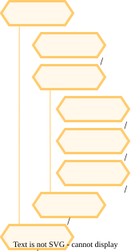
  </div>
  <div v-click="3">
    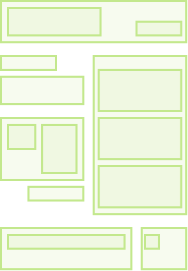
  </div>
  <div v-click="2">
    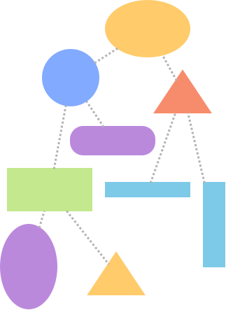
  </div>
  <div v-click="1">
    
  </div>
</div>

<v-drag-arrow pos="156,212,120,0" v-click="7" style="color:var(--brand-color-4)"/>
<v-drag-arrow pos="179,272,108,0" v-click="7" style="color:var(--brand-color-4)"/>
<v-drag-arrow pos="179,332,108,0" v-click="7" style="color:var(--brand-color-4)"/>
<v-drag-arrow pos="156,390,120,0" v-click="7" style="color:var(--brand-color-4)"/>

<v-drag-arrow pos="730,289,24,0" v-click="2" style="color:var(--brand-color-7)"/>
<v-drag-arrow pos="570,289,24,0" v-click="3" style="color:var(--brand-color-7)"/>
<v-drag-arrow pos="400,289,24,0" v-click="4" style="color:var(--brand-color-7)"/>


---
level: 3
---

# Потребители данных (эффекты)

<br/>
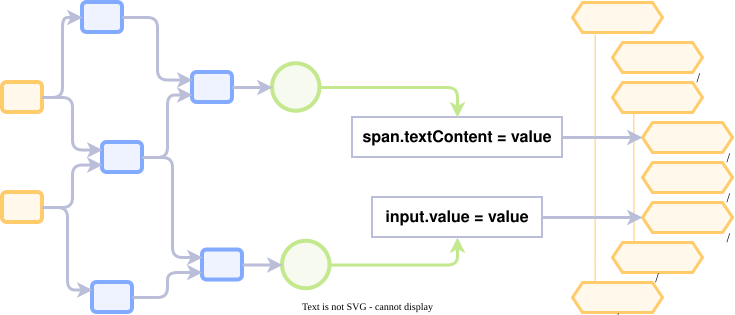

---
level: 3
---

# Инкрементальные вычисления

- Минимизация промежуточных вычислений
- Точечное обновление UI
- Код остаётся декларативным

---
level: 2
layout: section
---

# Декларативный TSX

---
level: 3
---

# Декларативное программирование

<v-clicks>

- Код описывает ожидаемый результат, а не способ его получения
  - Код описывает структуру UI, потоки данных, логику приложения <br/>в виде **деклараций**, а не последовательности действий
- Domain Specific Language (DSL) вместо универсального JavaScript
- Строгие абстракции:
  - Программист сосредоточен на семантике DSL
  - Детали реализации берёт на себя фреймворк

</v-clicks>

---
level: 3
---

<style>
  .slidev-code-wrapper {
    --slidev-code-font-size: 10px;
    --slidev-code-line-height: 1.3em;
  }
</style>

# Декларативность в UI-фреймворках

<div class="grid grid-cols-2 gap-4">
<div>

**<logos-vue/> Vue**

```html
<script setup>
import { ref } from 'vue'

const show = ref(true)
const list = ref([1, 2, 3])
</script>

<template>
  <button @click="show = !show">Toggle List</button>
  <button @click="list.push(list.length + 1)">Push</button>
  <button @click="list.pop()">Pop</button>
  <button @click="list.reverse()">Reverse List</button>

  <ul v-if="show && list.length">
    <li v-for="item of list">{{ item }}</li>
  </ul>
  <p v-else-if="list.length">List is not empty, but hidden.</p>
  <p v-else>List is empty.</p>
</template>
```

</div>
<div>

**<logos-svelte-icon/> Svelte**

```html
<script>
	import Thing from './Thing.svelte';

	let things = $state([
		{ id: 1, color: 'darkblue' },
		{ id: 2, color: 'indigo' }
	]);
	function handleClick() {
		things = things.slice(1);
	}
</script>

<button onclick={handleClick}> Remove first thing </button>
<div>
	<div>
		{#each things as thing (thing.id)}
			<Thing current={thing.color} />
		{/each}
	</div>
</div>
```

</div>
</div>

---
level: 3
---

# Декларативный TSX

<v-clicks>

- Подмножество TypeScript с семантикой инкрементальных вычислений
- Используется как "язык шаблонов" для UI-компонентов
- Поддерживает простую логику состояния, трансформации и привязки данных
- Сложная логика выносится за пределы языка в обычный TypeScript
- Взаимодействие с обычным TypeScript - через "границу" интеграции

</v-clicks>

---
level: 3
---

<style>
  th {
    font-weight: 700;
  }
  table {
    background-color: #0f111a77;
  }
  td, th {
    padding: 0.5rem;
  }
</style>

<br/>
<table>
  <tr>
    <th></th>
    <th>Декларативный TSX</th>
    <th>Языки шаблонов</th>
  </tr>
  <tr>
    <th>Типизация</th>
    <td>Уже типизирован TypeScript-ом</td>
    <td>Нужно интегрировать TypeScript (или писать свой typechecker?)</td>
  </tr>
  <tr>
    <th>Поддержка IDE</th>
    <td>Уже есть</td>
    <td>Нужны дополнительные расшинения, начиная с синтаксиса</td>
  </tr>
  <tr>
    <th>Гибкость языка</th>
    <td>Lexical scopes, замыкания, функции высшего порядка</td>
    <td>В разметке свои правила видимости имён, замыканий, передачи аргументов функций и т.п.</td>
  </tr>
</table>

---
level: 2
layout: section
---

# "Fine-grained reactivity"

---
level: 3
---

# Разновидности реактивности

<style>
li {
  margin-block: 0;
  line-height: 1.4rem;
}
</style>
<div class="grid grid-cols-2 gap-4">
<div class="card" style="--card-color:var(--brand-color-5)" v-click>
<div class="card-header">Ориентированные на данные</div>
<div class="card-body">

- первичные и производные данные
- граф зависимостей

</div>
<div class="card-footer flex justify-around text-xl"><span><logos-mobx/> MobX</span><span><logos-vue/> Vue</span><span><logos-solidjs-icon/> Solid</span></div>
</div>
<div class="card" style="--card-color:var(--brand-color-2)" v-click>
<div class="card-header">Ориентированные на события</div>
<div class="card-body">

- события и потоки данных
- трансформация, фильтрация, <br/>буферизация событий и т.п.

</div>
<div class="card-footer flex justify-around text-xl"><span><logos-reactivex/> Rx.js</span></div>
</div>
<div class="card" style="--card-color:var(--brand-color-3)" v-click>
<div class="card-header">Гибрид первых двух</div>
<div class="card-body">

- подробный граф из событий, <br/>данных и действий с ними

</div>
<div class="card-footer flex justify-around text-xl"><span><logos-effector/> Effector</span></div>
</div>
<div class="card" style="--card-color:var(--brand-color-6)" v-click>
<div class="card-header">Основанные на перевычислении</div>
<div class="card-body">

- rerender частей приложения
- reconcilliation результатов

</div>
<div class="card-footer flex justify-around text-xl"><span><logos-react/> React</span><span><logos-preact/> Preact</span></div>
</div>
</div>

---
level: 3
background: images/coffee.jpg
---

<style>
  .card {
    background-color: rgb(from var(--card-color) r g b / 10%);
  }
</style>

# "Гранулярность" реактивности

<div style="position:relative;height: 230px">
  <div class="fill-container" v-click.hide="1">
    
  </div>
  <div class="fill-container text-center grid grid-cols-4 gap-2 contrast-bg" v-click="1">
    <div class="card" style="--card-color:var(--brand-color-3)">
      <div class="card-header">Пересчитать всё</div>
    </div>
    <div class="card" style="--card-color:var(--brand-color-1)">
      <div class="card-header">"Coarse-grained reactivity"</div>
      <div class="card-body">
        <div class="flex justify-around text-3xl">
          <logos-react/> <logos-preact/>
        </div>
      </div>
    </div>
    <div class="card" style="--card-color:var(--brand-color-4)">
      <div class="card-header">"Fine-grained reactivity"</div>
      <div class="card-body">
        <div class="flex justify-around text-3xl">
          <logos-vue/> <logos-svelte-icon/> <logos-solidjs-icon/> <logos-mobx/>
        </div>
      </div>
    </div>
    <div class="card" style="--card-color:var(--brand-color-5)">
      <div class="card-header">Пересчитать инкрементально</div>
      <div class="card-body">
        <span class="text-3xl" v-click="2"><b>?</b></span>
      </div>
    </div>
  </div>
</div>

<v-drag-arrow v-click="1" pos="72,375,834,0" style="color:var(--brand-color-1)"/>

---
level: 3
---

# Сигналы (API)

```ts
type Signal<T> = {
  get: () => T
  set: (value: T) => void
}

type Computed<T> = {
  get: () => T
}

const signal = <T>(initValue: T): Signal<T> => { /* ... */ }
const computed = <T>(func: () => T): Computed<T> => { /* ... */ }
```

---
level: 3
---

<DeclarativeCode :clicks="[0,1]">

````md magic-move
```tsx
const OhmsLaw = () => {
  let voltage = 1.5   // U
  let resistance = 2  // R

  const amperage = voltage / resistance  // I

  return (
    <div>
      <p>Напряжение: <input type="number" value={voltage} onInput={e => {
        voltage = e.target.valueAsNumber
      }}/></p>
      <p>Сопротивление: <input type="number" value={resistance} onInput={e => {
        resistance = e.target.valueAsNumber
      }}/></p>
      <p>Сила тока: <span>{amperage}</span> А</p>
      <p>Мощность: <span>{amperage * voltage}</span> Вт</p>
    </div>
  )
}
```
```tsx
const OhmsLaw = () => {
  const voltage = signal(1.5)   // U
  const resistance = signal(2)  // R

  const amperage = computed(() => voltage.get() / resistance.get())  // I

  return (
    <div>
      <p>Напряжение: <input type="number" value={voltage} onInput={e => {
        voltage.set(e.target.valueAsNumber)
      }}/></p>
      <p>Сопротивление: <input type="number" value={resistance} onInput={e => {
        resistance.set(e.target.valueAsNumber)
      }}/></p>
      <p>Сила тока: <span>{amperage}</span> А</p>
      <p>Мощность: <span>{computed(() => amperage.get() * voltage.get())}</span> Вт</p>
    </div>
  )
}
```
````

</DeclarativeCode>


---
level: 3
---

# Преобразования кода

```ts {monaco-diff} {height:'auto',fontSize:'16px'}
let state = initExpression

const result = computationExpression(state)
~~~
const state = signal(currentOf(initExpression))

const result = computed(() => computationExpression(currentOf(state)))
```

<v-click>

где:

```ts
const currentOf = <T>(s: Computed<T> | T): T => {
  return s instanceof Computed ? s.get() : s
}
```

</v-click>

---
level: 3
---

<DeclarativeCode :clicks="[0,1]">

````md magic-move
```ts{all|7}
let lightswitch = true

let voltage = 5
let resistance1 = 1
let resistance2 = 1

const power = lightswitch ? voltage * voltage / (resistance1 + resistance2) : 0
```
```ts{7-10}
const lightswitch = signal(true)

const voltage = signal(5)
const resistance1 = signal(1)
const resistance2 = signal(1)

const power = computed(() =>
  lightswitch.get()
    ? (voltage.get() * voltage.get()) / (resistance1.get() + resistance2.get())
    : 0)
```
```ts{7-12}
const lightswitch = signal(true)

const voltage = signal(5)
const resistance1 = signal(1)
const resistance2 = signal(1)

const _voltageSquare = computed(() => voltage.get() * voltage.get())
const _resistance12 = computed(() => resistance1.get() + resistance2.get())
const power = computed(() =>
  lightswitch.get()
    ? _voltageSquare.get() / _resistance12.get()
    : 0)
```
```ts{7-13}
const lightswitch = signal(true)

const voltage = signal(5)
const resistance1 = signal(1)
const resistance2 = signal(1)

const _voltageSquare = computed(() => voltage.get() * voltage.get())
const _resistance12 = computed(() => resistance1.get() + resistance2.get())
const _power1 = computed(() => _voltageSquare.get() / _resistance12.get())
const power = computed(() => lightswitch.get() ? _power1.get() : 0)
```
````

</DeclarativeCode>

---
level: 3
---


---
level: 3
---

# Сигналы: Потеря реактивности

````md magic-move
```ts
const amperage = signal(2)
const resistance = signal(1)

const power = computed(() => amperage.get() * amperage.get() * resistance.get())
```
```ts{4-6}
const amperage = signal(2)
const resistance = signal(1)

const voltage = amperage.get() * resistance.get()  // --> 2

const power = computed(() => amperage.get() * voltage)  // --> 4
```
```ts{8-10}
const amperage = signal(2)
const resistance = signal(1)

const voltage = amperage.get() * resistance.get()  // --> 2

const power = computed(() => amperage.get() * voltage)  // --> 4

resistance.set(2)

console.log(power.get())  // 4
```
```ts{4|10}
const amperage = signal(2)
const resistance = signal(1)

const voltage = computed(() => amperage.get() * resistance.get())  // --> 2

const power = computed(() => amperage.get() * voltage.get())  // --> 4

resistance.set(2)

console.log(power.get())  // 8
```
````


---
level: 3
---

# Условный рендеринг

<DeclarativeCode :clicks="[0, 1]">

````md magic-move
```tsx{all|11}
const Counter = () => {
  let counter = 0

  return (
    <div>
      <button on:click={() => { counter++ }}>
        Увеличить счётчик
      </button>
      <p>{`Кнопка была нажата ${counter} раз!`}</p>
      <p>Это число{" "}
        <span>{counter % 2 === 0 ? <em>чётное</em> : <strong>нечётное</strong>}!</span>
      </p>
    </div>
  )
}
```
```tsx{11-15}
const Counter = () => {
  const counter = signal(0)

  return (
    <div>
      <button on:click={() => { counter.set(counter.get() + 1) }}>
        Увеличить счётчик
      </button>
      <p>{`Кнопка была нажата ${counter.get()} раз!`}</p>
      <p>Это число <span>
        {reIf(computed(() => counter % 2 === 0), (
          <em>чётное</em>
        ), (
          <strong>нечётное</strong>
        ))}!</span>
      </p>
    </div>
  )
}
```
````

</DeclarativeCode>


---
level: 3
---

<DeclarativeCode>

````md magic-move
```ts{all|1-12|14-16}
const f = (a: string, b: number) => {
  const c = a.toUppercase()
  const d = g(b * 2, 42)
  const e = g(100500, b * 3)
  return `${c} ${d} ${e}`
}

const g = (p: number, q: number) => {
  const pp = p * p
  const qq = Math.sqrt(q)
  return pp + qq
}

let a = "The Answer"
let b = 42
f(a, b)
```
```ts{1,16}
const f = (a: string, b: number) => {  // a = "The Answer", b = 42
  const c = a.toUppercase()
  const d = g(b * 2, 42)
  const e = g(100500, b * 3)
  return `${c} ${d} ${e}`
}

const g = (p: number, q: number) => {
  const pp = p * p
  const qq = Math.sqrt(q)
  return pp + qq
}

let a = "The Answer"
let b = 42
f(a, b)
```
```ts{2}
const f = (a: string, b: number) => {  // a = "The Answer", b = 42
  const c = a.toUppercase()  // c = "THE ANSWER"
  const d = g(b * 2, 42)
  const e = g(100500, b * 3)
  return `${c} ${d} ${e}`
}

const g = (p: number, q: number) => {
  const pp = p * p
  const qq = Math.sqrt(q)
  return pp + qq
}

let a = "The Answer"
let b = 42
f(a, b)
```
```ts{3-4}
const f = (a: string, b: number) => {  // a = "The Answer", b = 42
  const c = a.toUppercase()  // c = "THE ANSWER"
  const d = g(b * 2, 42)  // g(84, 42) = ?
  const e = g(100500, b * 3)  // g(100500, 126) = ?
  return `${c} ${d} ${e}`
}

const g = (p: number, q: number) => {
  const pp = p * p
  const qq = Math.sqrt(q)
  return pp + qq
}

let a = "The Answer"
let b = 42
f(a, b)
```
```ts{3,8-12}
const f = (a: string, b: number) => {  // a = "The Answer", b = 42
  const c = a.toUppercase()  // c = "THE ANSWER"
  const d = g(b * 2, 42)  // g(84, 42) = 7062.480740698408
  const e = g(100500, b * 3)  // g(100500, 126) = ?
  return `${c} ${d} ${e}`
}

const g = (p: number, q: number) => {  // p = 84, p = 42
  const pp = p * p  // pp = 7056
  const qq = Math.sqrt(q)  // q = 6.48074069840786
  return pp + qq  // 7062.480740698408
}

let a = "The Answer"
let b = 42
f(a, b)
```
```ts{4,8-12}
const f = (a: string, b: number) => {  // a = "The Answer", b = 42
  const c = a.toUppercase()  // c = "THE ANSWER"
  const d = g(b * 2, 42)  // g(84, 42) = 7062.480740698408
  const e = g(100500, b * 3)  // g(100500, 126) = 10100250011.224972
  return `${c} ${d} ${e}`
}

const g = (p: number, q: number) => {  // p = 100500, p = 126
  const pp = p * p  // pp = 10100250000
  const qq = Math.sqrt(q)  // q = 11.224972160321824
  return pp + qq  // 10100250011.224972
}

let a = "The Answer"
let b = 42
f(a, b)
```
```ts{5}
const f = (a: string, b: number) => {  // a = "The Answer", b = 42
  const c = a.toUppercase()  // c = "THE ANSWER"
  const d = g(b * 2, 42)  // g(84, 42) = 7062.480740698408
  const e = g(100500, b * 3)  // g(100500, 126) = 10100250011.224972
  return `${c} ${d} ${e}`  // "THE ANSWER 7062.480740698408 10100250011.224972"
}

const g = (p: number, q: number) => {
  const pp = p * p
  const qq = Math.sqrt(q)
  return pp + qq
}

let a = "The Answer"
let b = 42
f(a, b)
```
```ts{14}
const f = (a: string, b: number) => {  // a = "The Answer", b = 42
  const c = a.toUppercase()  // c = "THE ANSWER"
  const d = g(b * 2, 42)  // g(84, 42) = 7062.480740698408
  const e = g(100500, b * 3)  // g(100500, 126) = 10100250011.224972
  return `${c} ${d} ${e}`  // "THE ANSWER 7062.480740698408 10100250011.224972"
}

const g = (p: number, q: number) => {
  const pp = p * p
  const qq = Math.sqrt(q)
  return pp + qq
}

let a = "Any questions?"
let b = 42
f(a, b)
```
```ts{14,1,2,5}
const f = (a: string, b: number) => {  // a = "Any questions?", b = 42
  const c = a.toUppercase()  // c = "ANY QUESTIONS?"
  const d = g(b * 2, 42)  // g(84, 42) = 7062.480740698408
  const e = g(100500, b * 3)  // g(100500, 126) = 10100250011.224972
  return `${c} ${d} ${e}`  // "ANY QUESTIONS? 7062.480740698408 10100250011.224972"
}

const g = (p: number, q: number) => {
  const pp = p * p
  const qq = Math.sqrt(q)
  return pp + qq
}

let a = "Any questions?"
let b = 42
f(a, b)
```
```ts{15}
const f = (a: string, b: number) => {  // a = "Any questions?", b = 42
  const c = a.toUppercase()  // c = "ANY QUESTIONS?"
  const d = g(b * 2, 42)  // g(84, 42) = 7062.480740698408
  const e = g(100500, b * 3)  // g(100500, 126) = 10100250011.224972
  return `${c} ${d} ${e}`  // "ANY QUESTIONS? 7062.480740698408 10100250011.224972"
}

const g = (p: number, q: number) => {
  const pp = p * p
  const qq = Math.sqrt(q)
  return pp + qq
}

let a = "Any questions?"
let b = 43
f(a, b)
```
```ts{1,3-4,15|3,8,9,11|4,8,10,11}
const f = (a: string, b: number) => {  // a = "Any questions?", b = 43
  const c = a.toUppercase()  // c = "ANY QUESTIONS?"
  const d = g(b * 2, 42)  // g(86, 42) = 7062.480740698408
  const e = g(100500, b * 3)  // g(100500, 129) = 10100250011.224972
  return `${c} ${d} ${e}`  // "ANY QUESTIONS? 7062.480740698408 10100250011.224972"
}

const g = (p: number, q: number) => {
  const pp = p * p
  const qq = Math.sqrt(q)
  return pp + qq
}

let a = "Any questions?"
let b = 43
f(a, b)
```
````


<div v-drag="[413,66,387,435]">
  <div style="position:relative;height:100%">
    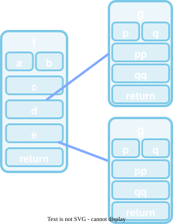
    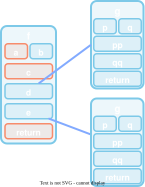
    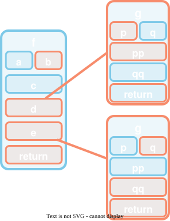
  </div>
</div>
</DeclarativeCode>

---
level: 3
---

<DeclarativeCode :clicks="[0,1]">

````md magic-move
```ts
const f = (a: string, b: number) => {
  const c = a.toUppercase()
  const d = g(b * 2, 42)
  const e = g(100500, b * 3)
  return `${c} ${d} ${e}`
}

const g = (p: number, q: number) => {
  const pp = p * p
  const qq = Math.sqrt(q)
  return pp + qq
}

let a = "Any questions?"
let b = 43
f(a, b)
```
```ts
const f = (a: Computed<string>, b: Computed<number>): Computed<string> => {
  const c = computed(() => a.get().toUppercase())
  const d = g(computed(() => b.get() * 2), 42)
  const e = g(100500, computed(() => b.get() * 3))
  return computed(() => `${c.get()} ${d.get()} ${e.get()}`)
}

const g = (p: Computed<number>, q: Computed<number>): Computed<string> => {
  const pp = computed(() => p.get() * p.get())
  const qq = computed(() => Math.sqrt(q.get()))
  return computed(() => pp.get() + qq.get())
}

const a = signal("Any questions?")
const b = signal(43)
f(a, b)
```
````

</DeclarativeCode>

---
level: 3
---

# Наблюдения

- Инкрементальные вычисления и сигнальная реактивность похожи
- Дерево вызовов функций <==> Дерево графов сигналов
- Порядок вычислений +- одинаковый
- Минимизация "лишних" перевычислений

---
level: 2
---

# Компиляция DSL в сигналы

<div class="grid grid-cols-2 gap-4">
  <div class="card" style="--card-color:var(--brand-color-4)" v-click>
    <div class="card-header">Преимущества</div>
    <div>
      <ul>
        <li><span v-mark.red="1">Выглядит</span> как TypeScript</li>
        <li>Нет boilerplate ".get()", ".set()", "signal()", "computed(() => ...)"</li>
        <li>Есть возможность автоматически оптимизировать</li>
      </ul>
    </div>
  </div>
  <div class="card" style="--card-color:var(--brand-color-3)" v-click>
    <div class="card-header">Недостатки</div>
     <div>
      <ul>
        <li>"Магия" порядка исполнения вычислений</li>
        <li>+1 шаг сборки</li>
        <li>Ограничения синтаксиса и используемых API</li>
      </ul>
    </div>
  </div>
</div>

---
level: 3
---

<style>
  li {
    margin-top: 0;
    margin-bottom: 0;
  }
</style>

# Декларативный TSX: ограничения

<div class="flex gap-4">
<div class="text-xs">

- **Запрещён "лишний" синтаксис:**
  - `class`, `this`, `new`, `delete`, `var`, `function`, циклы `for`-`in`, <br/> методы (в т.ч. `get`- и `set`-) и т.д.
- **"Белый список" API:**
  - нет прямого доступа к Web APIs
  - import-ить можно другие модули декларативного TSX
- **Чистота функций:**
  - отсутствие циклов, присваиваний, побочных эффектов
  - Изменения данных - только в специальных контекстах
- **Типизация:**
  - Запрет небезопасных `as`, `any`
  - Все property должны быть readonly, кроме тех, которые можно менять
- ...

</div>
<div style="flex:1 0 auto">
  
</div>
</div>

---
level: 3
---

# "Escape Hatches"

<div class="grid grid-cols-2 gap-4">
<div>

"Где мои ...?"

- `useEffect`
- `useRef`
- `watch`
- `watchEffect`
- `onMounted`
- `onUnmounted`
- и т.п

</div>
<div v-click>
  <br/>
  
</div>
</div>


---
level: 3
layout: image
image: images/cocktail.jpg
backgroundSize: contain
---

<!--
Ограничения применяются для файлов с расширениями `.decl.ts` и `.decl.tsx`. Запрещены ключевые слова class, this, new, delete, var, function, throw. enum, namespace, циклы for-in, методы, get- и set- методы, индексная сигнатура, доступ к свойствам объектов через оператор [], операции с прототипами, spread-оператор при создании и деструктуризации объектов, операторы сравнения == и !=. Ещё применяются type-aware правила, чтобы запретить тип any, запретить оператор as кроме приведения к надтипу, запретить операторы === и !== для сравнения ссылочных типов, кроме null, запретить let-переменные и не-readonly свойства со значениями функциональных типов. Будет существовать особая функция-маркер 'action' из пакета 'rwrtw' типа `(callback: () => void) => void`, которую можно вызывать только с аргументом стрелочной функции в виде `action(() => { /*код*/ })`, где код внутри подчиняется особым правилам. Вне кода, обёрнутого в action, запрещены все операторы присваивания и мутирующие операции массивов, разрешено использование идентификаторов и типов, импортированных только из файлов `.decl.ts` и `decl.tsx` или пакета 'rwrtw' или встроенных в стандартную библиотеку TypeScript. Внутри кода action разрешены присваивания и мутирующие операции массивов.
-->
---
level: 1
layout: section
---

# Вложенная реактивность

---
level: 2
---

# Объекты как значения

<DeclarativeCode :clicks="[0,1]">

````md magic-move
```ts
let a = 100500.0
let b = "Whatever"

const c = { foo: a, bar: b }
```
```ts
const a = signal(100500.0)
const b = signal("Whatever")

const c = computed(() => ({ foo: a.get(), bar: b.get() }))
```
```ts{4-6}
const a = signal(100500.0)
const b = signal("Whatever")

const c = computed(() => ({ foo: a.get(), bar: b.get() }))

const d = computed(() => `${c.get().foo} is ${c.get().bar}!`)
```
```ts
const a = signal(100500.0)
const b = signal("Whatever")

const c = { foo: a, bar: b }

const d = computed(() => `${c.foo.get()} is ${c.bar.get()}!`)
```
```ts{6-8}
const a = signal(100500.0)
const b = signal("Whatever")

const c = { foo: a, bar: b }

const { foo, bar } = c

const d = computed(() => `${foo.get()} is ${bar.get()}!`)
```
```ts{10}
const a = signal(100500.0)
const b = signal("Whatever")

const c = { foo: a, bar: b }

const { foo, bar } = c

const d = computed(() => `${foo.get()} is ${bar.get()}!`)

const e = computed(() => JSON.stringify(c))  // ???
```

```ts{10}
const a = signal(100500.0)
const b = signal("Whatever")

const c = { foo: a, bar: b }

const { foo, bar } = c

const d = computed(() => `${foo.get()} is ${bar.get()}!`)

const e = computed(() => JSON.stringify(snapshot(c)))
```
````

</DeclarativeCode>

---
level: 3
---

# Изменяемые объекты

<DeclarativeCode>

````md magic-move
```ts
let a = 100500.0
let b = "Whatever"

let c = { foo: a, bar: b }
```
```ts
let a = 100500.0
let b = "Whatever"

let c: {
  foo: number
  bar: string
} = { foo: a, bar: b }
```
```ts
let a = 100500.0
let b = "Whatever"

let c: {
  readonly foo: number
  readonly bar: string
} = { foo: a, bar: b }
```
````

</DeclarativeCode>

---
level: 3
---

# Реактивные массивы

<DeclarativeCode>

```tsx{all|1|2,3|5-7|9}
const weekdays: string[] = ["Пн", "Вт", "Ср", "Чт"]
const weekdaysUpper: readonly string[] = weekdays.map(wd => wd.toUppercase())
const weekdaysLower: readonly string[] = weekdays.map(wd => wd.toLowercase())

weekdays.push("Пт", "Сб", "Вс")
weekdays.splice(2, 1)
weekdays.sort()

reconcile(weekdays, ["Вт", "Чт", "Сб"])
```

</DeclarativeCode>

---
level: 3
---

<br/>
<div style="position:relative">
  <div class="fill-container">
    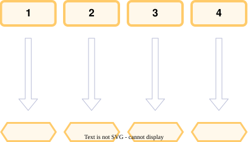
  </div>
  <div class="fill-container">
    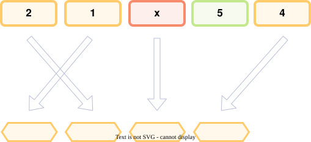
  </div>
  <div class="fill-container">
    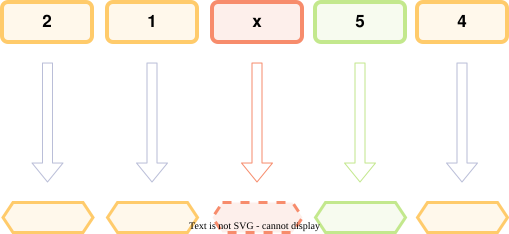
  </div>
  <div class="fill-container">
    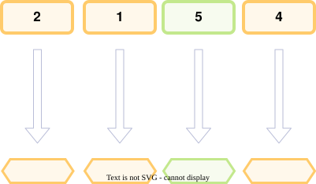
  </div>
</div>

---
level: 3
---

<style>
  .slidev-code-wrapper {
    --slidev-code-font-size: 15px;
    --slidev-code-line-height: 1.5em;
  }
</style>

<DeclarativeCode>

```tsx{all|1,3|9|8,13|16|11,12} {at:2}
type Todo = { task: string; done: boolean }
const TodoList = () => {
  const todos: Todo[] = [{ task: "Ничего", done: true }]
  let input: string = ""
  let showDone: boolean = false
  return (<>
    <input type="text" bind:value={input}>
    <button on:click={() => { todos.push(input); input = "" }}>Добавить</button>
    <ul>{todos.filter(({ done }) => !showDone || done).map(({ task, done }) => (
      <li>
        <input type="checkbox" bind:value={done}/>
        <input type="text" bind:value={task}/>
        <button on:click={() => { todos.splice(todos.indexOf(task), 1) }}>Удалить</button>
      </li>
    ))}</ul>
    <button on:click={() => { showOnlyDone = !showOnlyDone }}>
      Показать сделанные
    </button>
  </>)
}
```

</DeclarativeCode>

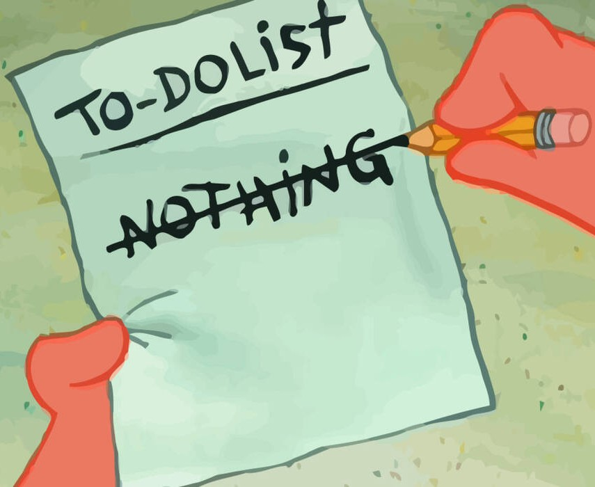

---
level: 3
---

# Вложенные объекты

```ts
type Data = {
  foo: { readonly a: string; readonly b: boolean } | null
  bar: {
    readonly c: number
    d: string | number
    readonly e: readoly boolean[]
  }[]
  baz: { readonly kind: "A"; a: string } | { readonly kind: "B"; b: number }
}
```

---
level: 2
layout: image
image: ./images/trees.jpg
class: text-center
---

<br/><br/>

<h1 class="contrast-bg">Древовидные данные</h1>

<div>
<p class="contrast-bg">Алгебраические типы данных</p>
<p class="contrast-bg">"Value-types"</p>
</div>


---
level: 3
---

<style>
  li {
    margin-top: 0;
    margin-bottom: 0;
    line-height: 1.2em;
  }
</style>

# Декларативный TSX: ограничения

<div class="flex gap-4">
<div>

- ...
- **Древовидные данные:**
  - Только объекты, массивы и примитивы
  - Копирование объектов, а не передача по ссылке
  - Запрет оператора `[]` для свойств объектов и индексной сигнатуры
  - Запрет сравнения объектов по ссылке (===)
- **Специальный API:**
  - реактивные массивы вместо обычных
  - `snapshot` и `reconcile` для вложенных данных

</div>
<div style="flex:1 0 auto">
  
</div>
</div>

---
level: 3
---

# Что осталось за кадром?

- callbacks, event handlers, render-props (slots)
- Context/Provide-Inject
- Keep-alive - кеширование состояния компонентов
- Асинхронная логика, например, запросы на сервер
- SSR, SSG

---
level: 3
---

# Примеры реализации похожих идей

- <logos-marko-icon/> Marko
- Compose - компиляторный плагин для <logos-kotlin-icon/> Kotlin
- "Реактивный CSS"
- QML - декларативный язык для <logos-qt/>

---
level: 1
layout: section
---

# Заключение

---
level: 1
---

# Заключение

<v-clicks>

- UI-фреймворк создаёт свою абстракцию - ментальная модель UI:
  - Чистая функция с инкрементальным исполнением - "fine-grained reactivity"
  - Декларативный DSL для описания структуры и логики UI
  - Строгие ограничения для поддержания абстракции
- Многие фреймворки приходят к этой концепции:
  - Те же соглашения и ограничения 
  - Те же паттерны и best practices
- 

</v-clicks>

---
level: 2
---

# Спасибо!

<div class="grid grid-cols-2 gap-4 items-center">
  <div>
    
  </div>
  <div>
    <div class="flex gap-x-2 text-2xl items-center"><div><b>Василий Алфертьев</b></div></div>
    <p><logos-telegram style="display: inline; width: 32px; height: 32px" /> <b>Telegram</b>: <a href="https://t.me/alfertev2012">@alfertev2012</a></p>
    <p><logos-github-icon style="display: inline; width: 32px; height: 32px;background:white;border-radius:50%"/> <b>GitHub</b>: <a href="https://github.com/alfertev2014">@alfertev2014</a></p>
  </div>
</div>
